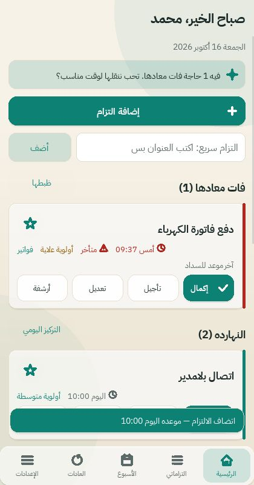
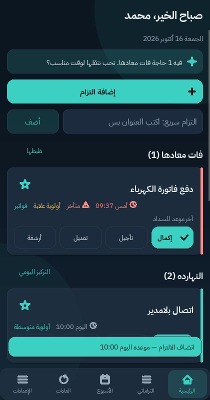
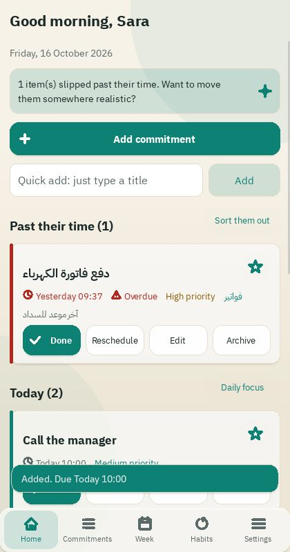

# SHAHER 2.0 — شاهر

A private, offline personal companion for **commitments and reminders** (habits are a small secondary feature).
Python 3 + Kivy + SQLite. Arabic (RTL) and English (LTR). No account, no internet, no analytics.

  

## What's new in 2.0
See [CHANGELOG.md](CHANGELOG.md). Highlights: **Arabic rendering fixed** (connected letters, correct order),
Arabic/English switch, light/dark/system themes with accent colours, onboarding with a preferred name,
dashboard rebuilt around commitments, Quick Add, Daily Focus & review, weekly overview, rescheduling,
contextual encouragement with quiet mode, backup / validated restore / CSV+JSON export.

## What is verified and what is not
| Item | Status |
|---|---|
| Business logic, SQLite, migrations (v1→v3 keep data) | **200 automated tests pass** (Linux, Python 3.12) |
| Arabic shaping + bidi (letters joined, order, numbers, Latin, brackets) | Verified against a real shaping renderer by pixel comparison; **not yet seen on Windows or Android screens** |
| UI on Linux (virtual display): both languages, light/dark, 360×640 + large text | Scripted tests pass, screenshots inspected |
| Settings survive an app restart | Verified by launching the real app twice |
| Windows 11 launch | **Not tested** (no Windows machine available) |
| Android reminders, permission prompt, reboot behaviour | Code written, **never compiled or run on a device** |
| Android APK | **Not built** (SDK/Gradle/Maven unreachable where this was developed) |

Details: [docs/TESTING.md](docs/TESTING.md), [docs/ARABIC_VERIFICATION.md](docs/ARABIC_VERIFICATION.md).

## Windows 11 quick start
1. Install Python **3.11 or 3.12** from python.org (tick *Add python.exe to PATH*).
2. Extract `SHAHER_2_0_Source.zip`, open the `SHAHER` folder.
3. Double-click `scripts\setup_windows.bat` (internet needed once: creates `.venv`, installs Kivy, arabic-reshaper, python-bidi, pytest).
4. Double-click `scripts\run_windows.bat`.

PowerShell equivalent:
```powershell
cd SHAHER
py -3 -m venv .venv
.\.venv\Scripts\python.exe -m pip install -r requirements-dev.txt
.\.venv\Scripts\python.exe main.py
```
**If you ran SHAHER 1.0 before:** just run 2.0 the same way. Your database is upgraded automatically (migration 3 only adds a column) and nothing is deleted. Make a backup first if you like (Settings → Create a backup).

Tests: `scripts\run_tests_windows.bat` or `.\.venv\Scripts\python.exe -m pytest tests -v`.

### Desktop keyboard shortcuts
`Ctrl+N` new commitment · `Ctrl+F` search · `Ctrl+1…5` Home / Commitments / Week / Habits / Settings · `Esc` back.

## Features
- **Commitments:** quick add (title only), full form, notes, due date/time, priority, category, edit, complete/reopen, archive/restore, delete (confirmed), **reschedule**, search, filter by status/priority/category, sort by urgency/date/priority.
- **Dashboard:** greeting with your name, add + quick add, overdue and today, honest daily progress, next days, compact habits entry.
- **Daily Focus & review:** star up to ~3 priorities, move what's left to tomorrow, peek at tomorrow. Optional and lightweight.
- **Weekly overview** with per-day add.
- **Reminders:** per commitment, configurable lead time and defaults, permission handling, test notification, battery-optimisation guidance. Desktop uses an in-app fallback (see limitations).
- **Habits (secondary):** unchanged logic and history, restyled.
- **Personalisation:** language, theme (light/dark/system), 7 accent colours + custom hex (auto-corrected for contrast), density, text size, corner style, subtle background, Arabic or Western digits, reduced motion, haptics (Android).
- **Encouragement:** real-data messages, off/gentle/normal, quiet mode, never shames, never popups.
- **Data:** local backup, validated restore (current data saved first), CSV/JSON export, reset preferences, separate double-confirmed delete-all.

## Limitations
- **Recurring commitments are not implemented** (deliberately: keeps the database stable).
- **Arabic text fields:** typed Arabic is shown correctly, but the caret stays at the end of the text (no mid-text editing in Arabic; use the ✕ clear button). English editing is fully normal. See ARABIC_VERIFICATION.md.
- **Reminders:** Windows shows them only while the app is open. Android uses WorkManager (approximate timing, can be delayed by battery saving); never claim guaranteed delivery.
- Haptics and system-theme detection on Android are unverified.

## Where data is stored
Windows `%APPDATA%\SHAHER\` (`shaher.db`, `backups\`, `exports\`, `logs\`); Android: app-private folder; override with `SHAHER_DATA_DIR`.
Dates are stored as local time without timezone (`YYYY-MM-DDTHH:MM`), habit days as local calendar dates.

## Project layout
```
main.py                    entry, app context, rebuild-on-preference-change
app/i18n/                  strings_ar.py, strings_en.py, t()
app/utils/arabic.py        display-only shaping/bidi (never touches stored text)
app/widgets/               theme (design system), icons, common (glass widgets, AInput), cards, dialogs, nav
app/screens/               home, commitments, form, week, review, habits, settings, onboarding
app/services/              commitments, habits, reminders, preferences, encouragement, quick_add, data_service ...
app/database/              connection + migrations (v1..v3)
android/src/...            Java reminder classes (WorkManager)
tests/  scripts/  docs/
```
Fonts: IBM Plex Sans Arabic (SIL OFL, bundled in `assets/fonts/`).
